# EasyBjets

**In-situ calibration of large-R $(b\bar{b})$-jets with the $Z(\to b\bar{b})+X$ topology in ATLAS**

Author: Thiziri Amezza (thiziri.amezza@cern.ch)

EasyBjets is the analysis framework that measures how well the simulation
describes the **energy and mass calibration of large-R $(b\bar{b})$-tagged
jets** in data, using the $Z(\to b\bar{b})$ peak as a standard candle.
It compares data and MC for the nominal calibration (before any correction) and
for each **correction** to it: the $(b\bar{b})$-jet regression models bJR10v00
and bJR10v01, and the $\mu$-in-jet correction. It provides the data/MC ratios of
each calibration and the double ratios correction / nominal with their
uncertainties, from which the non-closure uncertainty of each correction
relative to the nominal in-situ calibration is derived.

Two $Z(\to b\bar{b})+X$ **topologies** cover complementary $p_T$ ranges, each in
its own folder (the folder you run from selects the channel):

| Folder | Channel | Topology | The large-R $(b\bar{b})$-jet recoils against | $p_T$ range |
|---|---|---|---|---|
| `ZbbGamma/` | **DB** — Direct Balance | $Z(\to b\bar{b})+\gamma$ | a photon | 200–450 GeV |
| `ZbbJets/`  | **MJB** — Multijet Balance | $Z(\to b\bar{b})+\text{jets}$ | a system of small-R jets | 450–1200 GeV |

Four **observables**, from dedicated fits of the peak position and width in data and MC:
$(b\bar{b})$-jet energy scale (**b-JES**), $(b\bar{b})$-jet energy resolution (**b-JER**),
$(b\bar{b})$-jet mass distribution peak (**b-JMDP**) and $(b\bar{b})$-jet mass distribution resolution (**b-JMDR**).

| Observable | Measured from | Single ratio (data/MC) | Double ratio |
|---|---|---|---|
| **b-JES** | balance $R = p_T^{J} / p_T^{ref}$ | $R_{JES} = \langle R\rangle_{data} / \langle R\rangle_{MC}$ | $R_{JES}^{corr} / R_{JES}^{nom}$ |
| **b-JER** | width of $R$, truth width subtracted in quadrature | $R_{JER} = \sigma_{insitu} / \sigma_{insitu}^{MC}$ | $R_{JER}^{corr} / R_{JER}^{nom}$ |
| **b-JMDP** | $(b\bar{b})$-jet mass peak position | $\mu_{data} / \mu_{MC}$ | $\text{b-JMDP}^{corr} / \text{b-JMDP}^{nom}$ |
| **b-JMDR** | $(b\bar{b})$-jet mass peak width | $\sigma_{data} / \sigma_{MC}$ | $\text{b-JMDR}^{corr} / \text{b-JMDR}^{nom}$ |

with $\sigma_{insitu} = \sqrt{\sigma_{data}^{2} - \sigma_{truth}^{2}}$ and
$\sigma_{insitu}^{MC} = \sqrt{\sigma_{MC}^{2} - \sigma_{truth}^{2}}$,
$\sigma_{truth}$ being the width of $p_T^{truth\ jet} / p_T^{ref}$.

Four **calibrations** (variants) per channel:

| Variant key (DB / MJB) | In-situ calibration |
|---|---|
| `DB` / `MJB` | nominal (standard in-situ calibration) |
| `DB_bJER10v00` / `MJB_bJER10v00` | $(b\bar{b})$-jet transformer-based regression, model v00 |
| `DB_bJER10v01` / `MJB_bJER10v01` | $(b\bar{b})$-jet transformer-based regression, model v01 |
| `DB_MuonCorr` / `MJB_MuonCorr` | muon-in-jet correction |

The last three are the **corrections**. The performance of each is assessed with
the double ratio of every observable, correction relative to nominal.

### Analysis flow

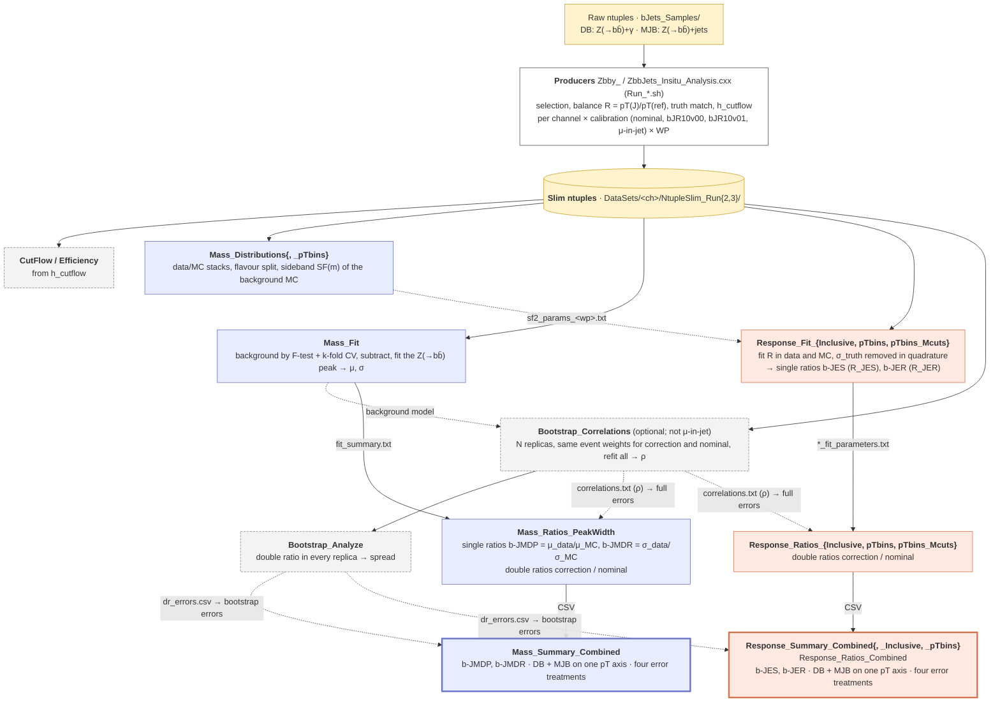


The diagram reads top to bottom in the order of a run: production, distributions
and checks, fits, bootstrap, double ratios, combined summaries. Colours mark the
two tracks: **blue** the mass track (b-JMDP, b-JMDR), **orange** the response
track (b-JES, b-JER); dashed boxes are the checks and the optional bootstrap, and
the thick-bordered boxes are the final figures. Every box is run per channel,
from `ZbbGamma/macros` (DB) or `ZbbJets/macros` (MJB), except the two summaries,
which read the CSVs of both channels. Solid arrows are the main chain; dotted
arrows are extra inputs one step takes from another (the `sf2_params` cache, the
`Mass_Fit` background model, `correlations.txt` for the full errors,
`dr_errors.csv` for the bootstrap errors). The figures in this README are
**toy illustrations** made with
[`doc/make_readme_figures.C`](doc/make_readme_figures.C), not results.


---

## Contents

1. [Layout](#1-layout)
2. [Setup and data access](#2-setup-and-data-access)
3. [Slim ntuple production (stage 0)](#3-slim-ntuple-production-stage-0)
4. [How to run a macro](#4-how-to-run-a-macro)
5. [Mass analysis (b-JMDP, b-JMDR)](#5-mass-analysis-b-jmdp-b-jmdr)
6. [Response analysis (b-JES, b-JER)](#6-response-analysis-b-jes-b-jer)
7. [Cutflow and efficiency](#7-cutflow-and-efficiency)
8. [Double-ratio errors and the bootstrap](#8-double-ratio-errors-and-the-bootstrap)
9. [Environment variables](#9-environment-variables)
10. [Output structure](#10-output-structure)
11. [Cross-checks](#11-cross-checks)
12. [Quick start](#12-quick-start)
13. [Tips and troubleshooting](#13-tips-and-troubleshooting)
14. [Status and known limitations](#14-status-and-known-limitations)

---

## 1. Layout

```
EasyBjets/
├── common/                          shared configuration and helpers
│   ├── RunEra.h                     run-era (Run-2 or Run-3) switch (EASYBJETS_RUN), plot folders, lumi label
│   ├── AtlasLabel.h                 ATLAS label of all plots (EASYBJETS_ATLAS_LABEL)
│   ├── WorkingPointConfig.h         D_xbb/GN2X working points (names, labels, branches)
│   ├── VariantConfig.h              variants (nominal or correction schemes), branches, paths, samples, pT bins, WP list
│   ├── BinningConfig.h              histogram binning algorithms (EASYBJETS_BINNING)
│   ├── MassCutConfig.h              optional jet-mass window (EASYBJETS_MASS_CUT)
│   ├── CorrelationConfig.h          bootstrap correlations for the "full" double-ratio errors
│   ├── BootstrapErrors.h            bootstrap double-ratio errors for the "bootstrap" summaries
│   ├── SFUtils.h                    sideband scale factor of the background MC
│   ├── CommonUtils.h                logging, fits, plotting, cutflow and bin helpers
│   ├── Insitu_Analysis.h            shared code of the two producers/slimmers
│   ├── Utils/                       ATLAS style
│   └── macros/                      the analysis code (*.h), shared by DB and MJB
├── ZbbGamma/                        DB channel
│   ├── Zbby_Insitu_Analysis.cxx     producer (raw ntuple $\rightarrow$ slim ntuple)
│   ├── Run_DB_Analysis_Run{2,3}.sh  producer drivers (+ Run_DB_MuonCorr.sh)
│   ├── macros/                      run macros (*.cxx, per analysis step); rootlogon.C
│   └── Run2Plots/ Run3Plots/        all outputs (created by the macros)
├── ZbbJets/                         MJB channel, same structure
│   ├── ZbbJets_Insitu_Analysis.cxx
│   ├── Run_MJB_Analysis_Run{2,3}.sh, Run_MJB_MuonCorr.sh
│   └── macros/
├── CrossChecks/                     production check, background-stability study
├── DataSets/                        slim ntuples (NtupleSlim_Run2/3 per channel)
└── doc/                             MassFitProcedure.tex, ResponseFitProcedure.tex, BootstrapProcedure.tex,
                                     make_readme_figures.C + figures/ (README sketches)
```

Each macro you run is a short wrapper, `<channel>/macros/<Name>.cxx`: it sets
the channel (DB or MJB) and calls the shared code in `common/macros/<Name>.h`,
so both channels always run the same analysis. Each header starts with a short
description: what the macro does, how to run it, its outputs and its options.

---

## 2. Setup and data access

**Requirements:** The macros run directly in ROOT
(`root 'Macro.cxx(...)'`); there is nothing to build or compile.

**Always run the macros from `<channel>/macros/`.** `rootlogon.C` in that folder
adds `../../common` to the include path, and all relative paths (data, plots)
start from there.

**Where the inputs are (October 2026):**

| Input | Location (lpnatlas) | Used by |
|---|---|---|
| raw ntuples (`GN2x_JetCalibxNtuple_*` productions) | `/data/atlas/tamezza/bJets_Insitu_Analysis/bJets_Samples/Run{2,3}/` | the producers `Zbby_` / `ZbbJets_Insitu_Analysis.cxx` ([§3](#3-slim-ntuple-production-stage-0)) |
| slim ntuples | `/data/atlas/tamezza/bJets_Insitu_Analysis/EasyBjets/DataSets/{ZbbGamma,ZbbJets}/NtupleSlim_Run{2,3}/` | all analysis macros: mass ([§5](#5-mass-analysis-b-jmdp-b-jmdr)), response ([§6](#6-response-analysis-b-jes-b-jer)), cutflow ([§7](#7-cutflow-and-efficiency)), bootstrap ([§8](#8-double-ratio-errors-and-the-bootstrap)) |

**Where the macros read the slim ntuples from:**

| Setting | Data folder |
|---|---|
| nothing set | `../../DataSets/<ZbbGamma\|ZbbJets>/` (the `DataSets/` of this repository) |
| `EASYBJETS_DATA_DIR=<dir>` | `<dir>/` (must contain `NtupleSlim_Run2/` and `NtupleSlim_Run3/`) |

The slim ntuples are a few GB, so the usual way to work locally is to mount
them with sshfs rather than copy them:

```bash
mkdir -p ~/lpnatlas_data
sshfs <user>@lpnatlas02:/data/atlas/tamezza/bJets_Insitu_Analysis/EasyBjets/DataSets ~/lpnatlas_data \
      -o reconnect,ServerAliveInterval=15,defer_permissions,volname=lpnatlas

export EASYBJETS_DATA_DIR=$HOME/lpnatlas_data/ZbbGamma    # DB, run from ZbbGamma/macros
export EASYBJETS_DATA_DIR=$HOME/lpnatlas_data/ZbbJets     # MJB, run from ZbbJets/macros
```

- If the mount gives `Input/output error`, it is stale: `umount -f ~/lpnatlas_data` and mount again.
- Reading over sshfs is slow for long chains (every macro reads the ntuples
  again, and the MJB files are large). For full runs, work on lpnatlas itself with
  `EASYBJETS_DATA_DIR=/data/atlas/tamezza/bJets_Insitu_Analysis/EasyBjets/DataSets/ZbbGamma`
  (or `ZbbJets`), or copy the WP folders you need to the local `DataSets/`.

---

## 3. Slim ntuple production (stage 0)

The producers read the raw ntuples (on lpnatlas, in
`/data/atlas/tamezza/bJets_Insitu_Analysis/bJets_Samples/`), apply the event
selection and write slim ntuples with:

- the selected large-R jet (`selected_ljet_index`) and the balance variables
  (`R_DB` / `R_MJB`, `R_truth_*`);
- the event `weight` and the cutflow histogram `h_cutflow`;
- in the nominal ntuple only, the bJR-corrected jet next to the nominal one
  (`ljet_bJR10v00_pt`, `ljet_bJR10v00_mass`, and the same for v01), which the
  bootstrap uses ([§8](#8-double-ratio-errors-and-the-bootstrap)).

```bash
cd ZbbGamma                       # on lpnatlas, where the raw samples are
./Run_DB_Analysis_Run3.sh         # nominal, bJER10v00, bJER10v01  (Run 2: Run_DB_Analysis_Run2.sh)
./Run_DB_MuonCorr.sh              # MuonCorr, from its own production

cd ../ZbbJets
./Run_MJB_Analysis_Run3.sh        # (Run 2: Run_MJB_Analysis_Run2.sh)
./Run_MJB_MuonCorr.sh
```

Each script sets `EASYBJETS_RUN`, then loops over the samples, jet types and
working points. The settings are the arrays at the top of each script; edit
them for a new production, another location or more WPs:

| Array | Content |
|---|---|
| `MC_FILES`, `DATA_FILES` | input files |
| `JET_TYPES` | `nominal`, `bJER10v00`, `bJER10v01` |
| `WORKING_POINTS` | only `0p46` so far (the nine-WP list is commented out) |

A single file can also be processed by hand:

```bash
root 'Zbby_Insitu_Analysis.cxx("<file>", isData, "<jetType>", "<wp>", isMuonCorr)'
#   jetType: nominal | bJER10v00 | bJER10v01      wp: 0p25 ... 1p55
```

**Output:** `DataSets/<channel>/NtupleSlim_Run{2,3}/<CH>_<variant>_<wp>wp_slim/<sample>_<variant>_<wp>wp_slim.root`,
for example `DB_nominal_0p46wp_slim/data_nominal_0p46wp_slim.root`.
The selection of each channel (one cutflow bin per cut) is described in the
header of its producer.

Check the production (truncated or empty files) before running the analysis:

```bash
cd CrossChecks && root 'check_production.C("run3","ALL")'
```

---

## 4. How to run a macro

```bash
cd ZbbGamma/macros                     # DB   (ZbbJets/macros for MJB)
export EASYBJETS_RUN=run3              # run2 or run3
export EASYBJETS_DATA_DIR=$HOME/lpnatlas_data/ZbbGamma   # only if not using ../../DataSets
export EASYBJETS_MASS_CUT=on           # jet mass 50-150 GeV: distributions and response (see below)
root 'Macro.cxx("arguments")'
```

**Jet-mass window (`EASYBJETS_MASS_CUT`):**

| Value | Selection |
|---|---|
| unset or `off` (default) | no mass cut |
| `on` | 50–150 GeV (the setting we use) |
| `lo:hi`, e.g. `40:170` | any window, in GeV |

Set it to `on` for `Mass_Distributions`, the response fits and ratios, and the
response cases of the bootstrap. `Mass_Fit` always uses the full mass range: it needs the sidebands to fit the background (for DB nominal they extend up to 160 GeV, because of the low statistics), so the cut is ignored there. All the variables are listed in [§9](#9-environment-variables).


**Variant argument.** Most macros take the variant as their first argument,
with the channel prefix:

| Argument | Runs |
|---|---|
| `"DB"` (`"MJB"`) | the nominal only |
| `"DB_bJER10v01"` | one variant (one correction) |
| `"ALL"` | all four variants of the channel |

```bash
root 'Response_Fit_Inclusive.cxx("ALL")'      # all four variants
root 'Mass_Fit.cxx("DB_bJER10v01")'           # one variant
```

**Combined summaries** The `*_Summary_Combined` macros show both channels, so
they take the corrections **without** the channel prefix: `"ALL"` or a
comma-separated list such as `"bJER10v01,MuonCorr"`.

**Order of a chain:** fits $\rightarrow$ bootstrap (optional) $\rightarrow$ ratios $\rightarrow$ combined summaries.
Each step only reads the files written by the previous ones, so run every step in **both** channels, with the **same** environment variables, before the combined summaries.

**Working points:** The macros run on the WPs returned by `AnalysisWPConfig::StandardWPs()` in `common/VariantConfig.h`, currently only
`"46"` (WP 0p46). The full list of nine WPs (0p25 … 1p55) is in the line commented out below it. 
To run on more WPs, enable that line, and produce the slim ntuples for those WPs first ([§3](#3-slim-ntuple-production-stage-0)).

---

## 5. Mass analysis (b-JMDP, b-JMDR)

| Step | Macro | Does |
|---|---|---|
| 1 | `Mass_Distributions.cxx("ALL")` | data/MC mass stacks, background flavour composition, sideband SF of the background (cached as `sf2_params_<wp>.txt`) |
| 1b | `Mass_Distributions_pTbins.cxx("ALL")` | the same in each $p_T$ bin (optional) |
| 2 | `Mass_Fit.cxx("ALL","inclusive")` | $Z (\to b\bar{b})$ peak fit: background function chosen by F-test + k-fold CV on the sidebands, subtracted, peak fitted in data and signal MC $\rightarrow$ $\mu$, $\sigma$ |
| 3 | `Mass_Ratios_PeakWidth.cxx("inclusive")` | b-JMDP, b-JMDR and their double ratios (uncorrelated, correlation-aware, full errors), CSV for step 4 |
| 4 | `Mass_Summary_Combined.cxx("ALL","combined","inclusive","inclusive")` | DB + MJB on one $p_T$ axis: single ratio, double ratio (four error treatments), data and MC $\mu$ / $\sigma$ |

### What the mass plots look like (toy sketches)

**Step 1 — data vs MC.** The large-R jet mass in data is compared to the $Z (\to b\bar{b})$ 
signal MC stacked on the main background MC ($\gamma$+jets for DB, multijets for MJB).
The background MC is scaled to data with a linear SF(m) fitted in the sidebands (grey). 
The background jets are also split by the b and c hadrons they contain.

<p align="center">
  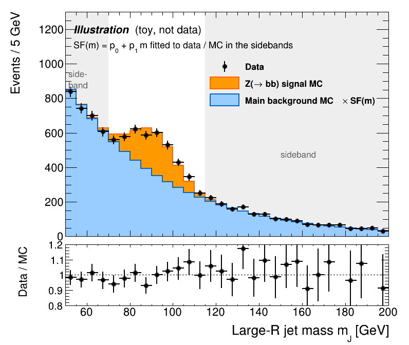
  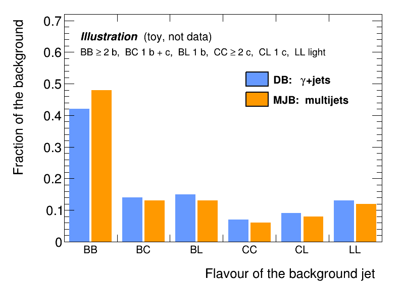
</p>

**Step 2 — peak extraction.** A background function is fitted to the data
sidebands (chosen among several families by F-test and cross-validation) and
extrapolated under the peak.

<p align="center">
  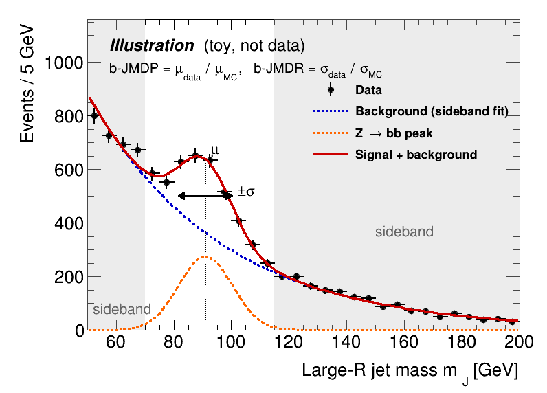
</p>

Subtracting it leaves the $Z (\to b\bar{b})$ peak in data, fitted with the same peak
function as the signal MC. Their $\mu$ and $\sigma$ give b-JMDP = $\mu_{data}$ / $\mu_{MC}$
and b-JMDR = $\sigma_{data}$ / $\sigma_{MC}$.

<p align="center">
  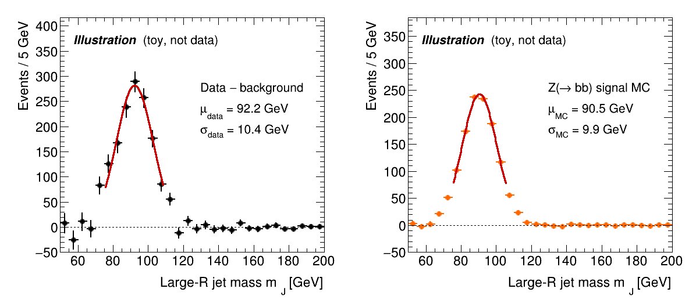
</p>

**Steps 3–4 — ratios and summary.** For each $p_T$ bin: the single ratio data/MC
of the nominal and of a correction (top), and their double ratio correction /
nominal (bottom), DB and MJB on one $p_T$ axis.

<p align="center">
  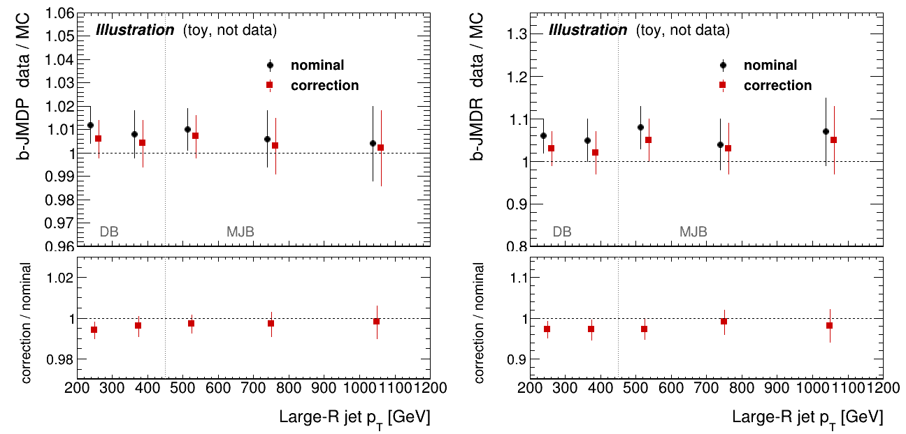
</p>

### Options and notes

- **$p_T$ mode** of steps 2–3: `"inclusive"` (one bin: DB 200–450, MJB 450–1200 GeV)
  or `"ptbins"` (DB 200–300, 300–450; MJB 450–750, 750–1200 GeV);
  `Mass_Ratios_PeakWidth("ALL")` does both. The bootstrap
  ([§8](#8-double-ratio-errors-and-the-bootstrap)) needs `Mass_Fit` in **both**
  modes, since it reuses its background model in every bin.
- `Mass_Summary_Combined(corrections, topology, dbPtMode, mjbPtMode)`:
  topology `combined`, `DB` or `MJB`. The two pT modes can differ (e.g. DB
  inclusive + MJB in pT bins) but must match the `Mass_Ratios_PeakWidth` runs.
- `Mass_Fit` uses the full mass range (it needs the sidebands), so
  `EASYBJETS_MASS_CUT` is ignored there. 
- Fit options: `EASYBJETS_FIT_MODEL` (peak shape), `EASYBJETS_GAUSS_FIT`,
  `EASYBJETS_BINNING`, `EASYBJETS_BKG_SELECT`, `EASYBJETS_CV_REGION`
  ([§9](#9-environment-variables)). `Mass_Ratios_PeakWidth`,
  `Mass_Summary_Combined` and the bootstrap must use the same values, since
  they set the folder names.

The mass fit is split into modules in `common/macros/`:

| Module | Holds |
|---|---|
| `Mass_Fit.h` | runs every fit using the modules below |
| `MassFit_Types.h` | the structs, settings and includes shared by all the modules |
| `MassFit_Models.h` | the 12 background functions: polynomial, exponential and polynomial x exponential, orders 2 to 5 |
| `MassFit_Signal.h` | the fit of the Z peak (data minus background, or signal MC): Gaussian by default, or Bukin, Crystal Ball, double-sided Crystal Ball |
| `MassFit_Selection.h` | the choice of the background function: F-test within each family, then k-fold cross-validation |
| `MassFit_Plots.h` | diagnostic plots of each fit and of the cross-validation |
| `Mass_SB_Plot.h` | data mass spectrum with the fitted background, signal and S+B curves, and a Data/(S+B) ratio |

Details of the procedure: [`doc/MassFitProcedure.tex`](doc/MassFitProcedure.tex).

---

## 6. Response analysis (b-JES, b-JER)

The response is measured in three binnings, which share one implementation:

| Binning | Fit | Ratios | Combined summary |
|---|---|---|---|
| inclusive | `Response_Fit_Inclusive.cxx("ALL")` | `Response_Ratios_Inclusive.cxx()` | `Response_Summary_Combined_Inclusive.cxx()` |
| pT bins x 3 mass bins | `Response_Fit_pTbins_Mcuts.cxx("ALL")` | `Response_Ratios_pTbins_Mcuts.cxx()` | `Response_Summary_Combined.cxx()` and `Response_Ratios_Combined.cxx()` |
| pT bins, inclusive in masses | `Response_Fit_pTbins.cxx("ALL")` | `Response_Ratios_pTbins.cxx()` | `Response_Summary_Combined_pTbins.cxx()` |

### What the response plots look like (toy sketches)

**Data vs MC:** The $p_T$ balance response in data $R^{data}$ is compared to the $Z (\to b\bar{b})$ signal in simulation $R^{MC}$
stacked on the main background MC (scaled with the sideband SF), here in one bin; the fits are done in every bin of the chosen binning.

<p align="center">
  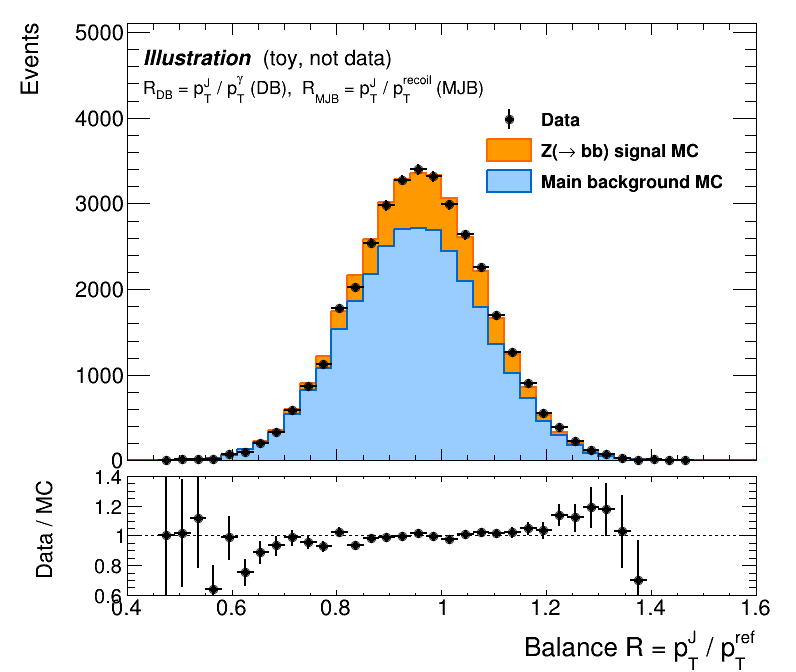
</p>

**The fit:** Response is fitted in data and MC with a double-sided Crystal Ball (DSCB):
a Gaussian core with a power-law tail on each side, so the low tail from
radiation and neutrinos is described rather than cut away. The mean of the Gaussian core
gives $R_{JES}$; its width, with the truth width (green) removed in quadrature,
gives $\sigma_{insitu}$ and $\sigma_{insitu}^{MC}$ used to compute $R_{JER}$. The code default is a Gaussian fit to the core only,
so the DSCB has to be selected:

    export EASYBJETS_FIT_MODEL=dscb      # outputs go to Run{2,3}Plots_dscb/

Use the same value for the fits, ratios and summaries.

<p align="center">
  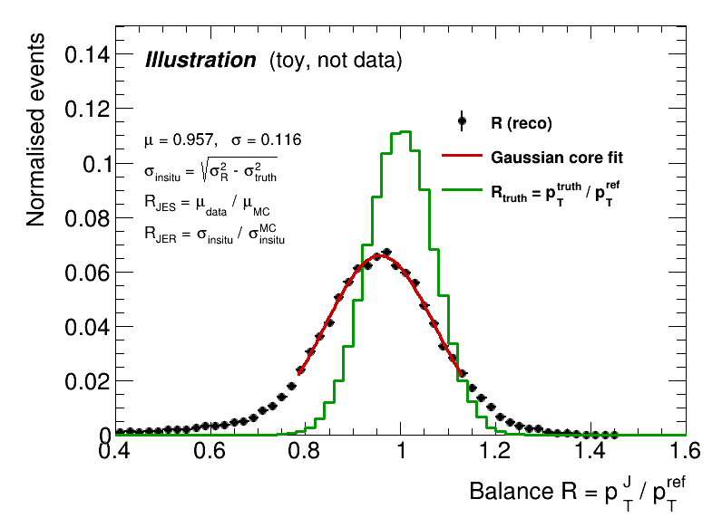
</p>

**Summary.** The same layout as for the mass, for b-JES ($R_{JES}$) and b-JER ($R_{JER}$).
The top panel shows the single ratio data/MC for the nominal and for one
correction scheme; the bottom panel shows their double ratio, correction / nominal.
DB and MJB combined on one pT axis.

<p align="center">
  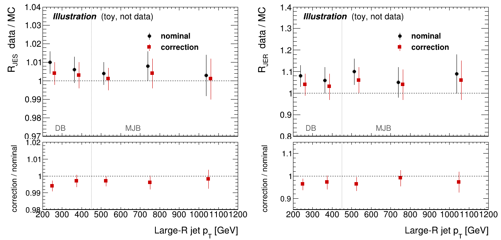
</p>

### Options and notes

- **Bins.** Jet pT: DB 200–300, 300–450 GeV; MJB 450–600, 600–900, 900–1200 GeV
  (the last bin of each channel has no upper edge; 450 and 1200 GeV are the axis
  limits). Jet mass: 50–80, 80–110, $\ge$ 110 GeV (110–150 GeV with `EASYBJETS_MASS_CUT=on`).
- **The fit**, for each variant, WP and bin:
  1. fill R for data, $Z (\to b\bar{b}$ signal) and the main background ($\gamma$+jets for DB,
     multijets for MJB);
  2. scale the background to data with the sideband SF(m);
  3. fit R in data and MC with a double-sided Crystal Ball, the model used for the results
     (`EASYBJETS_FIT_MODEL=dscb`; without it, the code defaults to an iterative Gaussian fit of the core);
  4. fit $\sigma_{truth}$, the width of $R_{truth}$ = pT(truth jet) / pT(ref), on MC jets
     matched to a truth jet (the non-detector part of the width, removed in quadrature);
  5. compute $R_{JES}$, $\sigma_{insitu}$, $R_{JER}$.
- `Response_Fit_Inclusive` reuses the SF cached by `Mass_Distributions`. Run
  that first with the same options; otherwise the SF is fitted again.
- The ratio macros take one correction (`"DB_bJER10v01"`) or, by default, all.
  They write the double ratios with the uncorrelated, correlation-aware ($\rho$ = 1)
  and full errors, and a CSV; the summaries add the bootstrap errors
  ([§8](#8-double-ratio-errors-and-the-bootstrap)).
- Summary arguments: `(corrections, topology)`, topology `combined`, `DB` or `MJB`;
  e.g. `Response_Summary_Combined.cxx("bJER10v01,MuonCorr","DB")`.
  `Response_Ratios_Combined.cxx("bJER10v01")` draws the double ratios of both
  channels on one 200–1200 GeV axis.
- `EASYBJETS_MASS_CUT=on` (50–150 GeV) is the usual setting for the response
  fits; use the same for the bootstrap.

Details of the procedure: [`doc/ResponseFitProcedure.tex`](doc/ResponseFitProcedure.tex).

---

## 7. Cutflow and efficiency

Both macros read the cutflow histogram `h_cutflow` written by the producers (in the slim ntuples).
They do not apply the selection again, so `EASYBJETS_MASS_CUT` has no effect.
The cuts are those of the producer selection (DB: 12 cuts, MJB: 8), described
in the header of `Zbby_` / `ZbbJets_Insitu_Analysis.cxx` and named in
`CutFlowUtils::DefaultCutNames`; the last cut is the ($b\bar{b}$)-tagging at the chosen WP.

```bash
cd ZbbGamma/macros                # ZbbJets/macros for MJB
export EASYBJETS_RUN=run3
export EASYBJETS_DATA_DIR=$HOME/lpnatlas_data/ZbbGamma
root 'CutFlow.cxx("ALL")'          # without argument: nominal only
root 'Efficiency.cxx("ALL")'
```

| Macro | Output, in `../Run{2,3}Plots/<variant>/` |
|---|---|
| `CutFlow.cxx` | `CutFlow/`: stacked cutflow with a data/MC panel; cutflow table (events per cut, summary, relative efficiencies); S/B and data/MC after the last cut, vs WP |
| `Efficiency.cxx` | `Efficiency/`: efficiency after each cut, per WP (data, signal and background overlaid) and per sample (all WPs overlaid), in log and linear scale |

- **Background normalisation:** DB: the $\gamma$+jets MC is scaled to data at the last cut before the ($b\bar{b}$)-tagging.
  MJB: the multijet MC keeps its cross-section x luminosity weights, since data and MC already agree after the ($b\bar{b}$)-tagging.
- **Efficiency errors:** Data: Clopper-Pearson 68% interval (the counts are integers), with its larger side used as a symmetric error bar.
  MC: binomial error with the event weights, from the sum of the squared weights.
  
---

## 8. Double-ratio errors and the bootstrap

The correction and the nominal are measured on (almost) the same events, so
their fit results are correlated, and the error of the double ratio is not the
simple quadrature sum of the fit errors. Every double ratio is therefore drawn
with four errors, each in its own folder of the summary plots:

| Folder | Treatment | Error bar |
|---|---|---|
| `uncorrelated/` | all inputs independent ($\rho = 0$) | fit errors added in quadrature (upper bound for $\rho \ge 0$) |
| `correlation_aware/` | correction and nominal fully correlated ($\rho = 1$) | fit errors with maximal cancellation (lower bound) |
| `full_correlation/` | $\rho$ measured by the bootstrap | fit errors propagated with the measured $\rho$: $\sqrt{c^{T}\,\Sigma\,c}$ |
| `bootstrap/` | no assumption on $\rho$ | spread of the double ratio itself over the bootstrap replicas |

Here $\Sigma$ is the covariance matrix of the fitted inputs ($\mu$ or $\sigma$
of data and MC, for the correction and the nominal; plus the truth width for
$\sigma_{insitu}$ and b-JER), built from their fit errors and the bootstrap
correlations $\rho$, and $c$ is the vector of derivatives of the double ratio
with respect to them. The correction enters the numerator and the nominal the
denominator, so a positive $\rho$ between the two reduces the error.

**`full_correlation` vs `bootstrap`.** Both use the bootstrap replicas
([Running the bootstrap](#running-the-bootstrap)), but take different things
from them:

| | Size of each input error | Correlations between inputs | Computed by |
|---|---|---|---|
| `full_correlation/` | the analysis fits (`Mass_Fit`, `Response_Fit_*`), e.g. $\mu_{data} \pm \delta\mu_{data}$ = 101.4 \pm 0.6$ GeV | measured over the replicas ($\rho$, `correlations.txt`) | the ratio macros, $\sqrt{c^{T}\,\Sigma\,c}$ |
| `bootstrap/` | not used | not needed: the double ratio is recomputed in every replica, and its error is half the 16–84 % range (`dr_errors.csv`) | `Bootstrap_Analyze`, read by the summaries |

- **`full`**: *"my fit errors are right; I only need to know how the correction and the nominal are correlated."*
  The **size** of each error comes from the analysis fits (e.g. $\mu_{data} = 101.4 \pm 0.6$ GeV from `Mass_Fit`); only the **correlations** $\rho$ come from the bootstrap.
  They are combined as $\sqrt{c^{T}\,\Sigma\,c}$.
- **`bootstrap`**: *"I don't rely on the fit errors; I measure the spread of the final result directly."*
  The fits are redone in every replica, and the error is the spread of the double ratio itself: sizes and correlations both come from the replicas.

`full_correlation` trusts the fit errors and only asks the bootstrap how the inputs move together; `bootstrap` relies on the replicas alone. 
When the two agree, the fit errors are complete and either can be used; when `bootstrap` is larger, the fits miss part of the fluctuation.


<p align="center">
  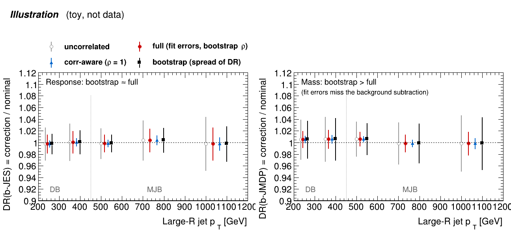
</p>

**How to read a summary.** DB covers $p_T$ = 200–450 GeV and MJB 450–1200 GeV.
A double ratio close to 1 means the correction changes data and MC in the same
way as the nominal. The four treatments share the central value and differ only
in the error bar. What a test can show:

- **`correlation_aware` is too small.** It assumes $\rho = 1$, so the errors of the correction and the nominal cancel almost entirely.
  The The measured $\rho$ by bootstrap is usually well below 1, so much less cancels and the true error is larger (underestimate the error).
  Use this treatment only as a lower bound.
- **`uncorrelated` is an upper bound** (for $\rho \ge 0$): nothing cancels (overestimate the error).
- **`full_correlation` and `bootstrap` should agree** when the fit errors describe the fluctuation completely.
  This is expected for the response (b-JES, b-JER), where R is fitted directly.
- **`bootstrap` can be larger for the mass** (b-JMDP, b-JMDR). The data peak is what remains after subtracting a background fitted on the sidebands.
  `Mass_Fit` treats that background as exactly known, while each replica refits it, so its fluctuation enters the spread.
  How large the difference is depends on the dataset, the bin and the background model.

If `bootstrap` is clearly larger than `full_correlation` for a point, the fit errors miss part of the fluctuation, and the bootstrap error is the more complete one.


### Running the bootstrap

Once per channel and run era, after the fits and before the ratio macros:

```bash
cd ZbbGamma/macros                                 # then ZbbJets/macros
export EASYBJETS_RUN=run3
export EASYBJETS_MASS_CUT=on                       # same as the response fits
export EASYBJETS_BOOT_N=200                        # number of replicas (default 200)
# Mass_Fit.cxx("ALL","inclusive") and ("ALL","ptbins") must have been run before,
# with the same EASYBJETS_RUN, _FIT_MODEL and _BINNING: the mass cases reuse its background model. 
# The response cases need nothing beforehand: the bootstrap fits the SF and R itself.
root 'Bootstrap_Correlations.cxx()'       # ρ per correction, observable and bin
root 'Bootstrap_Analyze.cxx()'            # double-ratio errors and diagnostics
```

<p align="center">
  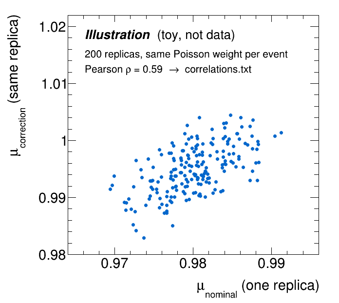
</p>

What the two macros do, for one case (observable x bin):

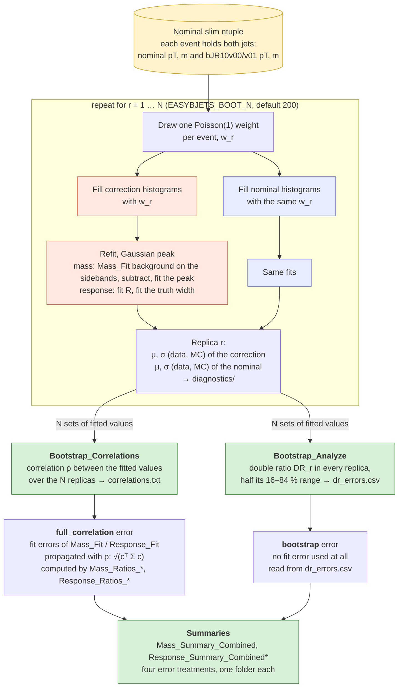

The correction and the nominal are read from the same events with the same weights, which is what preserves their correlation (and why both jets must be in the nominal tree). 
In each replica, **`Bootstrap_Correlations`** refits every case with the same steps as the analysis
(always with a Gaussian peak):

- **Mass, data.** The data contain the Z peak on top of a large background, so
  the background must be removed first:
  1. take the background function that `Mass_Fit` chose for this variant and $p_T$ bin (same family and order, read from its output);
  2. fit it again to the sidebands of this replica (the signal window is excluded), so it follows the fluctuation of the replica;
  3. subtract it from the data (negative bins set to 0), which leaves the Z peak;
  4. fit the peak with the iterative Gaussian of `Mass_Fit`, with the same mass range and binning: a first Gaussian in 80–115 GeV, then refits in
     $\mu \pm 2\sigma$ until $\sigma$ changes by less than 2 %.
- **Mass, MC.** The $Z (\to b\bar{b}) signal MC is already a pure peak, so it is fitted directly with the same iterative Gaussian.
- **Response (R).** R is fitted in data and in the combined MC (signal + main background scaled with the sideband SF, as in `Response_Fit_*`) with a
  two-pass Gaussian: a first fit in 0.7 < R < 1.3, then a refit in $\mu \pm 2\sigma$ of the first, which keeps the fit on the core and away from the low tail.
  The truth width $\sigma_{truth}$ is fitted the same way on the truth-matched signal jets only.

**`Bootstrap_Analyze`** then works case by case (one correction, WP, observable
and bin). In every replica it recomputes the double ratio of each observable
(b-JMDP, b-JMDR, b-JES, $\sigma_{insitu}$, b-JER), which gives N values of the
double ratio. Half of their 16–84 % range is the `bootstrap` error: the N values are sorted,
$q_{16}$ and $q_{84}$ are the values below which 16 % and 84 % of the replicas
lie, and the error is $(q_{84} - q_{16})/2$. For a Gaussian distribution this
equals one standard deviation, but it is not pulled up by a few replicas whose
fit failed.

From the same replicas it also computes the three linear errors (full, correlation-aware, uncorrelated), this time using the spread of each fitted input over the replicas instead of the fit errors. 
This is a check of the method:

- if the linear full error agrees with the `bootstrap` error, linear error propagation works for that case;
- the fit errors themselves are tested by comparing the `bootstrap` error with the `full_correlation` error of the ratio macros, which uses the fit errors.

Outputs, under `<channel>/Run{2,3}Plots/Bootstrap/`:

| Path | Written by | Content |
|---|---|---|
| `correlations.txt` | `Bootstrap_Correlations` | $\rho$ per correction, WP, observable and bin; read by the ratio macros |
| `diagnostics/` | `Bootstrap_Correlations` | fitted values of every replica, one file per case |
| `analysis/dr_errors.csv` | `Bootstrap_Analyze` | relative double-ratio error per case, four ways; read by the summaries |
| `analysis/<corr>_<wp>_<mass\|resp>_<bin>/` | `Bootstrap_Analyze` | per case: DR distributions, correlation matrix, marginals, variance decomposition, `summary.txt` |
| `analysis/dr_errors_<corr>_<obs>.pdf` | `Bootstrap_Analyze` | the four errors of one observable in every bin |

Then run the ratio macros and the summaries with

```bash
export EASYBJETS_CORR_METHOD=bootstrap      # "file" does the same
```

The ratio macros read `correlations.txt` of their channel (or the file given in `EASYBJETS_CORRELATIONS`); the summaries read `dr_errors.csv` of both channels. 
Without these files the defaults apply, and two folders become copies of others:

- `full_correlation/` falls back to $\rho$ = 1 between correction and nominal and 0 between data and MC, which is the `correlation_aware/` error;
- `bootstrap/` falls back to the `full_correlation` error.

The combined summaries (`Mass_Summary_Combined`, `Response_Summary_Combined`, `Response_Summary_Combined_Inclusive` / `_pTbins`) 
and the overlay `Response_Ratios_Combined` (DB + MJB on one pT axis, one colour per mass bin) draw every double ratio with all four errors, one folder each, including
`full_correlation/` and `bootstrap/`. The overlay also has a `comparison/` folder with the `full_correlation` and `bootstrap` error bars side by side.

**Limits of the method**

*What is not covered*

- **MuonCorr gets no bootstrap.** The correction and the nominal are read from
  the nominal ntuple, which carries both jets. MuonCorr is a separate
  production, and the slim ntuples keep no event or run number, so its events
  cannot be matched to the nominal ones. For MuonCorr, `full_correlation/`
  falls back to $\rho$ = 1 and `bootstrap/` shows the `full_correlation` error.
- **The selection is the nominal one.** The jet choice and the preselection
  are those of the nominal calibration, so an event that would pass only with
  the corrected jet is missing. This matters only for events close to a
  selection cut, mostly at the lowest pT edge.

*What is simplified with respect to the analysis fits*

- **Mass background:** the function `Mass_Fit` chose for that bin is refitted in each replica, but not chosen again.
- **Response:** R is fitted with a two-pass Gaussian rather than the analysis fit.
- **Gaussian peaks only.** The bootstrap ignores `EASYBJETS_FIT_MODEL` and always writes to `Run{2,3}Plots/Bootstrap/`.
  With a non-Gaussian model (e.g. `dscb`, used for the response results), the `full_correlation` and `bootstrap` errors shown with those fits still come from Gaussian replicas.

*Where the errors are not meaningful*

- In bins with few events (the small DB pT x mass bins) the width fits are unstable, in `Mass_Fit` as in the bootstrap, and their errors should not be used.

The method, the list of cases and the options are described in the headers of `common/macros/Bootstrap_Correlations.h` and `Bootstrap_Analyze.h`.

> **TODO: keep `eventNumber` and `runNumber` in the slim ntuples.** This fixes
> the first two limits at once: each variant could be read from its own slim
> ntuple, with its own jet choice and selection, and matched event by event to
> the nominal. MuonCorr would then be measured, and the nominal-selection
> limit would disappear. It needs a reprocessing of the slimming. 

> **Status (October 2026).** The method is complete and was tested on the
> local DB sample. It has not been reviewed yet, and has not been run on the
> full data or on MJB. When using it:
> - compare `full_correlation/` and `bootstrap/`: where they agree, the fit
>   errors are complete; where `bootstrap` is larger (possible for the mass,
>   see above), the bootstrap error is the more complete one;
> - treat `correlation_aware/` as a lower bound only: the measured $\rho$ is
>   usually well below 1.
>
> Feedback on the approach is welcome.

---

## 9. Environment variables

Set them before starting; each macro prints the values it uses.
The ones marked $\star$ change an output folder name, so they must be
**identical along a chain**, from the fits to the summaries, or the later steps.

### General

| Variable | Values (default **bold**) | Effect |
|---|---|---|
| `EASYBJETS_RUN` $\star$ | `run2` \| **`run3`** | ntuple folder, plot folder `Run{2,3}Plots`, lumi label |
| `EASYBJETS_DATA_DIR` | path (**`../../DataSets/<channel>`**) | folder holding `NtupleSlim_Run2/3` |
| `EASYBJETS_MASS_CUT` | **unset** \| `off` \| `on` (50–150 GeV) \| `lo:hi` | jet-mass window applied in the distributions, the response fits and the bootstrap response cases; not in the mass fit, which needs the sidebands. It does **not** change folder names, so runs with and without the cut overwrite each other: keep it the same along a chain |
| `EASYBJETS_ATLAS_LABEL` | **`Internal`** \| `Preliminary` \| `"Simulation Internal"` \| any text \| `none` | text after "ATLAS" on every plot (default in `common/AtlasLabel.h`) |
| `EASYBJETS_SAVE_PNG` | **unset** \| `1` | also save the canvases as PNG |

### Samples and minor backgrounds (compile-time, in `common/VariantConfig.h`)

The sample list is **not** an environment variable: the file names, legend
labels and colours of each channel are the `SampleConfig` tables in
`common/VariantConfig.h`, and the alternative samples (e.g. Sherpa vs Pythia
$\gamma$+jets, Zqq$\gamma$ MadGraph) are chosen there. The minor backgrounds are two
`#define`s in the same file, off by default:

| `#define` | Default | Enables |
|---|---|---|
| `EASYBJETS_DB_MINOR_BKGS` | 0 | DB: tt$\gamma$, W(qq)$\gamma$, Z(qq)$\gamma$ |
| `EASYBJETS_MJB_MINOR_BKGS` | 0 | MJB: top, W(qq)+jets, Z(qq)+jets |

Set them to 1 in the file; the samples must have been produced by the `Run_*.sh` scripts.

### Mass fit (`Mass_Fit`)

| Variable | Values (default **bold**) | Effect |
|---|---|---|
| `EASYBJETS_FIT_MODEL` $\star$ | **`gauss`** \| `bukin` \| `cb` \| `dscb` \| `all` | peak shape; a non-default model writes to `Run{2,3}Plots_<model>` (`dgauss` exists only in the response fits) |
| `EASYBJETS_GAUSS_FIT` | **`iterative`** \| `windowshop` | method of the Gaussian peak fit |
| `EASYBJETS_BINNING` $\star$ | **`fixed`** \| `fd` \| `scott` \| `sturges` \| `peakaware` | mass histogram binning; tags the folder (`<ptbin>_<binning>`) |
| `EASYBJETS_BKG_SELECT` | **`cv`** \| `dof` | background choice: k-fold CV with the 1-SE rule, or fewest parameters among the F-test finalists |
| `EASYBJETS_CV_REGION` | **`sidebands`** \| `full` | region on which the CV is scored |
| `EASYBJETS_SHOW_SPURIOUS` | **unset** \| `1` | print the spurious-signal test (maybe needed in future) |
| `EASYBJETS_SIDEBAND1_LOW/HIGH`, `EASYBJETS_SIDEBAND2_LOW/MAX` | GeV | override the sidebands (also used by the SF fits) |
| `EASYBJETS_MASS_XMIN/XMAX` | GeV | override the mass range |

### Response fits (`Response_Fit_*`)

| Variable | Values (default **bold**) | Effect |
|---|---|---|
| `EASYBJETS_FIT_MODEL` $\star$ | **`gauss`** \| `bukin` \| `cb` \| `dscb` \| `dgauss` \| `all` | peak shape; a non-default model writes to `Run{2,3}Plots_<model>`. The response results use `dscb` |
| `EASYBJETS_FIT_MODE` | **`scan`** \| `scan_dense` \| `scan_log` \| `legacy` \| `legacy7grid` | how the Gaussian fit window is chosen |
| `EASYBJETS_FIT_NSIGMA`, `EASYBJETS_FIT_NSIGMA_LIST` | e.g. `2.0`, `"1.0,1.5"` | window half-width (`legacy`), windows scanned (`scan`) |
| `EASYBJETS_FIT_MODEL_NSIGMA_LO/HI` | **3** / **2** | window of the non-Gaussian models, in $\sigma$ below / above the peak |
| `EASYBJETS_FIT_ERR_SCALE` | **unset** \| `pdg` | scale the fit errors by $\sqrt{\chi^2/\mathrm{ndf}}$ when > 1 |
| `EASYBJETS_SEED_MODE` | **`truncated`** \| `raw` | seed of the MC fits: the data window, or the raw mean $\pm$ RMS |
| `EASYBJETS_RESPONSE_FIT_LO` | **0.3** | lowest R used in the fits (negative = no floor) |
| `EASYBJETS_RESPONSE_FIT_PTMIN` | GeV (**unset**) | per-pT-bin floor R > PTMIN / pT_low |
| `EASYBJETS_RESPONSE_BINNING_MODE` | **`static`** \| `dynamic` | R histogram bins from `VariantConfig.h`, or computed from the data |
| `EASYBJETS_BINNING`, `EASYBJETS_BINNING_TRUTH`, `EASYBJETS_BINNING_MAX_BINS(_TRUTH)`, `EASYBJETS_BINNING_CORE_BINS` | | bin algorithm and limits, used only in `dynamic` mode (`EASYBJETS_BINNING` is the same variable as in the mass fit) |

### Ratios, summaries and correlations

| Variable | Values (default **bold**) | Effect |
|---|---|---|
| `EASYBJETS_CORR_METHOD` | **`rho1`** \| `file` | source of ρ for the `full_correlation` errors: $\rho$ = 1 between correction and nominal, or the correlations measured by the bootstrap (`boot` / `bootstrap` are aliases of `file`) |
| `EASYBJETS_CORRELATIONS` | path (**`../Run{2,3}Plots/Bootstrap/correlations.txt`**, then `./correlations.txt`, the old location) | correlation file read with `file` |
| `EASYBJETS_SUMMARY_VARIANTS` | e.g. `bJER10v01,MuonCorr` | extra summary plots with a subset of corrections |
| `EASYBJETS_HEATMAP_JES_RANGE`, `EASYBJETS_HEATMAP_JER_RANGE` | `"lo,hi"` (**0.90,1.10** / **0.60,1.40**) | colour range of the response heat maps |
| `EASYBJETS_YRANGE_<JES\|JER\|JMDP\|JMDR>_<SR\|DR\|COMP>` | `"lo,hi"` | fixed y range of a summary panel (SR single ratio, DR double ratio, COMP the data and MC values: b-JES / b-JER, or $\mu$ / $\sigma$ in GeV), e.g. to give Run 2 and Run 3 the same scale |

The `bootstrap/` folders of the summaries and of `Response_Ratios_Combined` need
no variable: they read `../../<channel>/Run{2,3}Plots/Bootstrap/analysis/dr_errors.csv`
of both channels, and fall back to the `full_correlation` error where it is missing.

### Bootstrap (`Bootstrap_Correlations`, `Bootstrap_Analyze`)

| Variable | Values (default **bold**) | Effect |
|---|---|---|
| `EASYBJETS_BOOT_N` | **200** | number of replicas |
| `EASYBJETS_BOOT_SEED` | **42** | random seed |
| `EASYBJETS_BOOT_OUTPUT` | path (**`../Run{2,3}Plots/Bootstrap/correlations.txt`**) | correlation file written |
| `EASYBJETS_BOOT_MC` | **`combined`** \| `signal` | MC of the response cases: signal + SF-weighted main background (as in the fits), or signal only |

The bootstrap also reads `EASYBJETS_RUN`, `EASYBJETS_MASS_CUT` and, for the
mass cases, the `EASYBJETS_FIT_MODEL` / `EASYBJETS_BINNING` of the `Mass_Fit`
run whose background model it reuses. It ignores `EASYBJETS_FIT_MODEL` for its
own fits (Gaussian only, [§8](#8-double-ratio-errors-and-the-bootstrap)), and
its output always goes to `Run{2,3}Plots/Bootstrap/`, whatever the fit model,
so runs with different models overwrite each other.

---

## 10. Output structure

Everything goes to `<channel>/Run3Plots/` (`Run2Plots` for run2;
`Run{2,3}Plots_<model>` for a non-default `EASYBJETS_FIT_MODEL`, except the
bootstrap, which always writes to `Run{2,3}Plots/Bootstrap/`). Below, `<ch>` is
`DB` or `MJB`, `<variant>` a variant key (`DB`, `DB_bJER10v00`, …),
`<calibration>` its tag (`nominal`, `bJER10v00`, `bJER10v01`, `MuonCorr`),
`<wp>` a working point (`0p46`) and `<treatment>` one of `uncorrelated`,
`correlation_aware`, `full_correlation`, `bootstrap`.

```
Run3Plots/
├── <variant>/                                   per-variant plots and fit results
│   ├── Mass_Distributions/<wp>/                 mass stacks, SF fit, sf2_params_<wp>.txt
│   ├── Mass_Distributions_pTbins/<wp>/<ptbin>/  the same per pT bin
│   ├── Mass_Fit_<ch>/<wp>/<ptbin>_<binning>/    fit_summary.txt, optimal_fit_parameters.txt,
│   │                                            F-test, CV, one folder per F-test finalist
│   ├── FitResponse_<calibration>/<wp>/          inclusive response fit: *_fit_parameters.txt,
│   │                                            Fit_R_balance_*.pdf, JER_results.txt
│   ├── Response_Fit_pTbins_Mcuts_<ch>/<wp>/     response fits in pT bins
│   │   ├── {50-80GeV, 80-110GeV, MassGE110GeV}/ per mass bin (Response_Fit_pTbins_Mcuts)
│   │   ├── MassInclusive/                       no mass bins (Response_Fit_pTbins)
│   │   └── Summary/                             overview of the bins
│   ├── CutFlow/                                 cutflow plots and tables
│   └── Efficiency/                              efficiency plots
├── Mass/                                        mass ratios and summaries (all variants)
│   ├── Mass_Ratios_Width/Combined/WP_<wp>_<ptmode>_<binning>/
│   │                                            b-JMDP, b-JMDR double ratios + Combined_Mass_Ratio_Summary.csv
│   └── Combined_Mass/<wp>/<treatment>/          DB + MJB mass summary
├── Response/                                    response ratios and summaries (all variants)
│   ├── Ratios/<ch>_Inclusive_Ratio/<wp>/        inclusive double ratios + Summary_Inclusive_Ratios_<wp>.csv
│   ├── Ratios/<ch>_Ratio_<variant>/<wp>/R2pTbin[_MassInclusive]/
│   │                                            pT-binned double ratios + Summary_Ratios_<wp>.csv
│   └── Combined_Ratios/<wp>/                    DB + MJB response plots
│       ├── Summary_DataMC/<treatment>/          single + double ratios, pT x mass bins
│       ├── Summary_Response/                    data and MC response, pT x mass bins
│       ├── Summary_Inclusive/<treatment>/       the same, inclusive
│       ├── Summary_pTbins_Inclusive/<treatment>/  the same, pT bins without mass cut
│       ├── <treatment>/                         Response_Ratios_Combined: double ratios vs pT,
│       │                                        one colour per mass bin
│       └── comparison/                          the same, full_correlation and bootstrap side by side
└── Bootstrap/                                   
    ├── correlations.txt                         ρ for the full_correlation errors
    ├── diagnostics/                             fitted values of every replica
    └── analysis/                                dr_errors.csv, dr_errors_<corr>_<obs>.pdf,
                                                 one folder per case
```

The combined summaries and `Response_Ratios_Combined` read the CSVs of
**both** channels (`../../ZbbGamma/...` and `../../ZbbJets/...`) and write to
the channel they are run from.

---

## 11. Cross-checks

Run from `CrossChecks/`:

| Macro | Checks |
|---|---|
| `check_production.C("run3","ALL")` | every slim ntuple opens and has a non-empty `nominal` tree. Finds the truncated or empty files a crashed producer leaves behind. Channel `DB`, `MJB` or `ALL` |
| `MassFit_BackgroundStability.C("run3","DB")` | how much $\mu$, $\sigma$, b-JMDP and b-JMDR move between the background functions kept by the `Mass_Fit` F-test (a background-modelling systematic). Run after `Mass_Fit`; writes to `<channel>/Run{2,3}Plots/<ch>_BackgroundStability/` |

`check_production.C` looks for the ntuples in a local `DataSets/` folder only (it does not read `EASYBJETS_DATA_DIR`), so run it on lpnatlas or on a local copy, not through the sshfs mount.

---

## 12. Quick start

Full inclusive chain, both channels, Run 3, with the bootstrap errors. Each
step reads what the previous ones wrote, so the order is: distributions and
fits, bootstrap, ratios, then the combined summaries once both channels are
done ([§4](#4-how-to-run-a-macro)). Start from the root of the repository.

```bash
EASYBJETS_HOME=$(pwd)                     # the clone of this repository
DATA=$HOME/lpnatlas_data                  # the DataSets/ folder (§2)
export EASYBJETS_RUN=run3
export EASYBJETS_MASS_CUT=on              # 50-150 GeV; ignored by Mass_Fit
export EASYBJETS_CORR_METHOD=file         # use the bootstrap ρ in the ratios (§8)

for ch in ZbbGamma ZbbJets; do
  cd $EASYBJETS_HOME/$ch/macros
  export EASYBJETS_DATA_DIR=$DATA/$ch

  # distributions and fits
  root 'Mass_Distributions.cxx("ALL")'
  root 'Response_Fit_Inclusive.cxx("ALL")'
  root 'Mass_Fit.cxx("ALL","inclusive")'

  # bootstrap (optional). It measures every pT bin too, so it needs the
  # pT-binned mass fit, whose background models it reuses.
  root 'Mass_Fit.cxx("ALL","ptbins")'
  root 'Bootstrap_Correlations.cxx()'
  root 'Bootstrap_Analyze.cxx()'

  # bootstrap (optional: to run without it, skip these two lines and do not set
  # EASYBJETS_CORR_METHOD above)
  root 'Bootstrap_Correlations.cxx()'
  root 'Bootstrap_Analyze.cxx()'

  # double ratios
  root 'Response_Ratios_Inclusive.cxx()'
  root 'Mass_Ratios_PeakWidth.cxx("inclusive")'
done

# combined DB + MJB summaries; the plots go to the channel they are run from
cd $EASYBJETS_HOME/ZbbGamma/macros             # or in ZbbJets
root 'Response_Summary_Combined_Inclusive.cxx()'
root 'Mass_Summary_Combined.cxx()'
```

- **pT-binned response** ([§6](#6-response-analysis-b-jes-b-jer)): add
  `Response_Fit_pTbins_Mcuts.cxx("ALL")` and `Response_Fit_pTbins.cxx("ALL")`
  to the fits, `Response_Ratios_pTbins_Mcuts.cxx()` and
  `Response_Ratios_pTbins.cxx()` to the ratios, and
  `Response_Summary_Combined.cxx()`, `Response_Summary_Combined_pTbins.cxx()`
  and `Response_Ratios_Combined.cxx()` to the summaries.
- **DSCB response fits** (the model used for the response results): run the
  same chain with `export EASYBJETS_FIT_MODEL=dscb`. The outputs then go to
  `Run3Plots_dscb/`, except the bootstrap (always `Run3Plots/Bootstrap/`, Gaussian fits).
- **Cutflow and efficiency** ([§7](#7-cutflow-and-efficiency)) can be run at any
  point after the production.

---

## 13. Tips and troubleshooting

**Symptoms**

- **`no rows` / `cannot open` in a summary.** A previous step is missing in
  one channel, or was run with another `EASYBJETS_RUN`, `EASYBJETS_FIT_MODEL`,
  `EASYBJETS_BINNING` or pT mode (these name the folders,
  [§9](#9-environment-variables)). Rerun it with the same environment; the
  summary prints the CSV path it looked for.
- **Data files "do not exist".** Check `EASYBJETS_DATA_DIR` and the sshfs
  mount ([§2](#2-setup-and-data-access)), using the path printed in the message.
- **Macro or headers not found.** You are not in `<channel>/macros/`;
  `rootlogon.C` there sets the include path ([§2](#2-setup-and-data-access)).
- **`Unknown variant '<key>'`.** Fits, ratios and the bootstrap take the full
  key (`DB_bJER10v01`); the combined summaries take the correction without the
  channel prefix (`bJER10v01`) ([§4](#4-how-to-run-a-macro)).
- **Results changed after a rerun with other options.** `EASYBJETS_MASS_CUT`
  does not change folder names, and the bootstrap always writes to
  `Run{2,3}Plots/Bootstrap/` whatever the fit model, so a rerun with another
  value overwrites the previous outputs. Keep them the same along a chain.
- **`full_correlation/` identical to `correlation_aware/`.**
  `EASYBJETS_CORR_METHOD` is not `file`, or `correlations.txt` is missing for
  this era; the ratio macro prints which file it loaded
  ([§8](#8-double-ratio-errors-and-the-bootstrap)).
- **`bootstrap/` identical to `full_correlation/`.** `dr_errors.csv` is
  missing for that channel or era (or the correction is MuonCorr, which the
  bootstrap does not measure); the summary prints how many points had a
  bootstrap value ([§8](#8-double-ratio-errors-and-the-bootstrap)).
- **Bootstrap warns "no Mass_Fit result ... exp_2 used".** Run `Mass_Fit` in
  both pT modes (`"inclusive"` and `"ptbins"`) first, with the same
  `EASYBJETS_RUN`, `_FIT_MODEL` and `_BINNING` as the bootstrap.
- **Old `correlations.txt` in `macros/`.** It is only read if the new file
  (`Run{2,3}Plots/Bootstrap/correlations.txt`) is missing, and its old-format
  lines are skipped with a warning. Delete it once the bootstrap has run.
- **A producer "succeeded" but a slim ntuple is empty or truncated.** The run
  scripts ignore ROOT's segfault exit code; run `CrossChecks/check_production.C`
  ([§11](#11-cross-checks)) before the analysis.

**Extending the framework**

- **Adding a working point.** Produce it (`WORKING_POINTS` in the `Run_*.sh`
  scripts, [§3](#3-slim-ntuple-production-stage-0)), then add it to
  `AnalysisWPConfig::StandardWPs()` in `common/VariantConfig.h`.
- **Adding a variant.** Add one entry to the registry in
  `common/VariantConfig.h` (branches, path tag, label, bins) **and** its key to
  `GetPrimaryVariantKeys(channel)` in the same file, which is the list `"ALL"`
  runs over. If its jet is stored in the nominal tree, the bootstrap measures it
  too; otherwise (like MuonCorr) its `full_correlation` error falls back to $\rho$ = 1.
- **Git ignores my new file.** `.gitignore` is a whitelist: everything is
  ignored unless listed. Add the new path to it.


---

## 14. Status and known limitations

Status as of October 2026 (v2.1).

**Complete and used for the Run 2 and Run 3 results:** the producers, the mass
and response analyses, cutflow and efficiency, the double ratios and the
combined DB + MJB summaries.

**Partial or open:**

| | Status | Where |
|---|---|---|
| Working points | only 0p46 produced; the code handles the nine-WP list | [§3](#3-slim-ntuple-production-stage-0), [§13](#13-tips-and-troubleshooting) |
| Bootstrap errors (`full_correlation/`, `bootstrap/`) | method complete and tested on the local DB sample; not reviewed yet, not yet run on the full data or on MJB | [§8](#8-double-ratio-errors-and-the-bootstrap) |
| Bootstrap fit model | Gaussian peaks only, while the response results use DSCB: the bootstrap $\rho$ and spread come from Gaussian fits | [§8](#8-double-ratio-errors-and-the-bootstrap) |
| MuonCorr in the bootstrap | not measured ($\rho$ = 1 by construction). Fix: keep `eventNumber` / `runNumber` in the slim ntuples (needs a reprocessing of the slimming), which would also remove the nominal-selection limit for the other corrections | [§8](#8-double-ratio-errors-and-the-bootstrap) |
| Inputs | personal area on lpnatlas, to be moved to a group area | [§2](#2-setup-and-data-access) |
| Documentation | this README, the header of every macro, `doc/*.tex` for the fit procedures | [§1](#1-layout) |

**Versions** are git tags. `git tag -n` lists them; `git diff --stat v1.0 v2.0`
shows what changed between two.

| Tag | Content | Use it for |
|---|---|---|
| `v1.0` | cleaned and documented mass and response analyses, cutflow/efficiency, central ATLAS label | reproducing results without the `bootstrap/` error treatment |
| `v2.0` | bootstrap studies: replicas with the `Mass_Fit` background models and the combined MC, double-ratio errors for all observables (`Bootstrap_Analyze`), `bootstrap/` folders in the summaries | the analysis with all four error treatments |
| `v2.1` | this README and `doc/` (toy sketches, procedure notes); all four error treatments also in the DB + MJB overlay `Response_Ratios_Combined` | the current analysis, with documentation |

Things a new user will most likely want to change first: the sample paths in
the `Run_*.sh` scripts ([§3](#3-slim-ntuple-production-stage-0)),
`EASYBJETS_DATA_DIR` ([§2](#2-setup-and-data-access)), and the WP list
([§13](#13-tips-and-troubleshooting)).

---

*Author: Thiziri Amezza (thiziri.amezza@cern.ch). Large-R (bb̄)-jet in-situ
calibration analysis pipeline, developed within the b-jet task force of the
ATLAS Collaboration, 2024–2026.*
